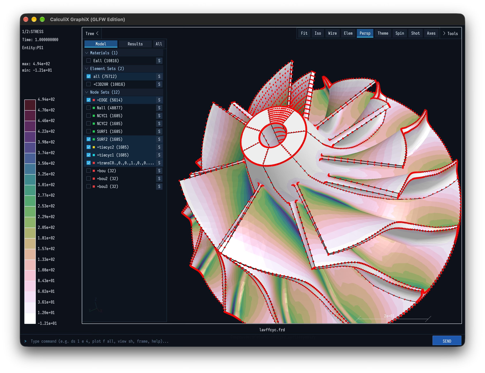

# CalculiX GraphiX (GLFW Edition)

[](cgx_2.23/COPYING)
[](#quick-install)
[](#highlights)
[](#paraview-export)

[CalculiX GraphiX (CGX)](https://www.dhondt.de/) is the open-source three-dimensional pre- and post-processor for finite-element analysis written by Klaus Wittig. This edition replaces the legacy X11, GLX, and GLUT windowing stack with a native GLFW3 and OpenGL renderer so that CGX builds and runs from a single codebase on Linux, macOS, and Windows.

All core CGX geometry, meshing (`libSNL`), batch commands, macro scripts (`.fbl`), and file parsers (`.frd`, `.inp`, `.stl`, `.step`) are preserved.



## Highlights

- **Single-source cross-platform builds and installers.** Compiles from one [`CMakeLists.txt`](CMakeLists.txt) on Linux (`x86_64` and `ARM64`), macOS (Apple Silicon), and Windows (`x86_64` MinGW-w64). One-line installers (`install.sh`, `install.ps1`) and pre-built release binaries are provided for all three operating systems.
- **Native GLFW3 windowing and modern OpenGL rendering.** Windowing, mouse, keyboard, and menus are routed through [GLFW3](https://www.glfw.org/), paired with packed Vertex Buffer Objects (VBOs), GLSL shaders, Blinn-Phong metallic surface lighting, and state-isolated 2D HUD overlays.
- **Vector typography with 3-tier UI scaling.** Built-in `stb_truetype` rendering replaces legacy X11/GLUT bitmap fonts and supports Small (`14pt`), Medium (`20pt`, default), and Big (`32pt`) text scaling across menus, labels, and the command bar.
- **Dark mode, 3D perspective, and Cubehelix colormap by default.** Launches in dark slate (`#0D121A`) with 3D perspective projection, shaded results enabled, and the perceptually monotonic `cubehelix (reversed)` colormap (grayscale-print-safe and colorblind-friendly).
- **Interactive command bar and trackpad/mouse navigation.** Includes command history (<kbd>↑</kbd>/<kbd>↓</kbd>), Levenshtein typo suggestions (e.g., `fram` → `frame`), modifier-key pan/zoom for trackpads and mice, and a right-click cascading context menu.
- **Optional interactive HUD overlays.** Provides a collapsible top-right `Tools` bar (`F2` / `view hud`) anchored to the 3D viewport (`Fit`, `Iso`, `Wire`/`Fill`, `Elem`, `Persp`, `Theme`, `Disp`, `1/2`, `2x`, `Spin`, `Axes`), a clickable 3D orientation `Axes` widget (`F3` / `view axes`), a collapsible top-left `Tree` drawer (`F4` / `view tree`) with `Model` (materials, element sets, geometry, prefix-colored node sets, visibility toggles, Solo `S`, `All`) and `Results` (datasets and components) tabs, and turntable auto-rotation and recording (`rot auto`, `movie turntable`). All overlays are hidden by default, adapt to Dark/Light mode, and are excluded from PNG, GIF, and MP4 captures.
- **Native media capture and ParaView export.** Saves PNG screenshots (`hcpy`), animated GIFs, and MP4 recordings (when `ffmpeg` is available) without requiring ImageMagick, and exports models and time-step results directly to `.vtu` and `.pvd` (`send all vtu all`).
- **Integrated TetGen tetrahedral meshing.** Includes native 3D tetrahedral meshing via [TetGen](https://wias-berlin.de/software/index.jsp?id=TetGen&lang=1) alongside CGX's structured hexahedral and sweep meshers.
- **Automated headless verification.** A 24-test headless suite (`tests/run_tests.py` / CTest) validates geometry, hexahedral/wedge sweeping, TetGen meshing, exports, and post-processing across all four CI matrix targets.

## Compared with upstream CalculiX GraphiX

Upstream CalculiX GraphiX is the reference implementation. The table summarizes what this edition changes or adds relative to upstream CGX 2.23:

| | Upstream CGX 2.23 | This edition |
|:---|:---|:---|
| **Windowing & Graphics** | X11 / GLX / GLUT | GLFW3 + OpenGL (VBOs, GLSL shaders, metallic lighting, isolated 2D HUD) |
| **Typography** | X11 / GLUT bitmap fonts | `stb_truetype` vector fonts with 3-tier UI scaling (`14pt` / `20pt` / `32pt`) |
| **Build & Platforms** | Platform-specific Makefiles (primarily Linux/Unix) | Single `CMakeLists.txt` for Linux (`x86_64`, `ARM64`), macOS, and Windows, plus installers and release binaries |
| **Defaults** | White background, orthographic projection, classic colormap | Dark slate (`#0D121A`), 3D perspective, shaded results, `cubehelix (reversed)` |
| **Interactive HUD & Tree** | Keyboard commands and right-click menu | Optional viewport-anchored Tools bar (`F2`), clickable Axes (`F3`), Model/Results Tree (`F4`), turntable spin & recording |
| **2D Plotting** | PostScript / `gv` | High-DPI PNG (`pngcairo`), SVG, PDF via Gnuplot + generated `graph_<Nr>.py` Matplotlib scripts |
| **Screenshots & Video** | External ImageMagick (`import`) | Native PNG (`hcpy`), GIF, and MP4 (via `ffmpeg`) |
| **ParaView Export** | External converters or `.frd` readers | Native `send all vtu all` (`.vtu` / `.pvd`) |
| **Verification** | Manual inspection | 24 automated headless tests (`tests/run_tests.py` / CTest) on 4 CI platforms |

## Contents

- [Quick install](#quick-install)
- [Pre-built binaries](#pre-built-binaries)
- [Controls and commands](#controls-and-commands)
- [ParaView export](#paraview-export)
- [Build system (CMake)](#build-system-cmake)
- [Verification](#verification)
- [Relationship to upstream CalculiX](#relationship-to-upstream-calculix)
- [Companion project: CalculiX CrunchiX Multi-Solver Edition](#companion-project-calculix-crunchix-multi-solver-edition)
- [Documentation](#documentation)
- [About this project](#about-this-project)
- [Attribution and license](#attribution-and-license)

## Quick install

### Linux and macOS

```bash
/bin/bash -c "$(curl -fsSL https://raw.githubusercontent.com/carlomontec/CalculiX-GraphiX-GLFW/main/install.sh)"
```

The installer installs `cgx_glfw` (and creates a user-space `cgx` alias in `~/.local/bin`) using either a pre-built release binary (`--binary`) or a local CMake build (`--build` / `--head`), without requiring `sudo`.

### Windows (PowerShell)

```powershell
irm https://raw.githubusercontent.com/carlomontec/CalculiX-GraphiX-GLFW/main/install.ps1 | iex
```

Run from anywhere once installed:

```bash
cgx_glfw test/beam_modal.frd
cgx_glfw model.frd model.inp    # Load results together with .inp sets & materials
```

Prerequisites, installer flags, uninstall instructions (`uninstall.sh`), and manual build steps are documented in [INSTALL.md](INSTALL.md).

## Pre-built binaries

Standalone executables, installers, and `SHA256SUMS.txt` checksums are published on the [Releases page](https://github.com/carlomontec/CalculiX-GraphiX-GLFW/releases):

| Platform | Assets | Notes |
|:---|:---|:---|
| **macOS (`arm64`)** | `CalculiX-GraphiX-GLFW-macOS-arm64.dmg`, `cgx_glfw-macos-arm64` | Static GLFW; no Homebrew runtime dependency. |
| **Windows (`x86_64`)** | `CalculiX-GraphiX-GLFW-Setup-windows-x86_64.exe`, `cgx_glfw-windows-x86_64.exe` | Installer registers `.frd`/`.fbl`/`.inp` associations; static GLFW and MinGW runtime. |
| **Linux (`x86_64` & `arm64`)** | `cgx_glfw-linux-<arch>.tar.gz`, `cgx_glfw-linux-<arch>` | Built on Ubuntu 22.04 (`glibc 2.35`) with static GLFW 3.4 (runtime `dlopen` for X11/Wayland); `.tar.gz` includes user-space `.desktop`/MIME installer. |

### Security notice (unsigned binaries)

Release binaries are not signed with commercial Apple Developer ID or Windows Authenticode certificates. Verify downloads against `SHA256SUMS.txt` before running:

- **macOS Gatekeeper:** Ad-hoc signed downloads carry `com.apple.quarantine`. Clear it in Terminal or allow the binary in **System Settings → Privacy & Security → Open Anyway**:
  ```bash
  xattr -cr "/Applications/CalculiX GraphiX GLFW.app"
  xattr -d com.apple.quarantine cgx_glfw-macos-arm64
  ```
- **Windows SmartScreen:** Click **More info → Run anyway** when prompted for unsigned `.exe` downloads.

## Controls and commands

### Mouse and keyboard gestures

| Gesture / Shortcut | Action |
|:---|:---|
| **Left Click + Drag** | Orbit / rotate 3D model around model center |
| **Shift + Left Drag** or **Ctrl/Cmd + Drag** | Pan / translate model horizontally and vertically |
| **Alt / Option + Left Drag** | Smooth continuous zoom |
| **Scroll Wheel** or **Trackpad Pinch** | Step zoom |
| **Right Click + Drag** | Pan (drag threshold ≥ 4 px) |
| **Right Click** (tap & release) | Open multi-level cascading context menu |
| **`F2`** | Toggle collapsible HUD Tools bar |
| **`F3`** | Toggle interactive orientation Axes |
| **`F4`** | Toggle collapsible Model & Results Tree |

### Common interactive commands

Type commands in the bottom command bar (run `cgx_glfw --help` for the CLI summary or see [`cgx_2.23/doc/cgx.pdf`](cgx_2.23/doc/cgx.pdf) for the full manual):

| Command | Action |
|:---|:---|
| `frame` | Fit and center the model in the viewport |
| `rot iso` / `rot dim` / `rot tri` | Isometric, dimetric, or trimetric orientation |
| `rot auto [deg/s\|on\|off]` | Start, set speed, or stop turntable auto-rotation |
| `view persp` / `view ortho` | Switch between 3D perspective and orthographic projection |
| `view dark` / `view light` | Switch between Dark Mode (`#0D121A`) and Light Mode |
| `view hud [on\|off]` / `view axes [on\|off]` / `view tree [on\|off]` | Toggle HUD Tools bar, interactive Axes, or Model & Results Tree |
| `ds <step> e <comp>` | Load and display result dataset (e.g., `ds 4 e 4`) |
| `plot fv all` / `plot f all` / `plot e all` | Plot filled contours, filled surfaces, or element wireframe |
| `cmap <palette>` | Switch colormap (`cubehelix`, `coolwarm`, `turbo`, `viridis`, `inferno`, `jet`, `classic`) |
| `anim real` | Start real-time modal or transient animation |
| `hcpy [name]` | Save viewport screenshot directly to PNG (`hcpy_1.png` or `<name>.png`) |
| `movie cycle [name.mp4\|name.gif]` | Record one full cycle to MP4 (via `ffmpeg`) or GIF |
| `movie turntable [name.mp4\|name.gif] [frames]` | Record a 360° turntable MP4 or GIF |
| `graph <set> l +` | Plot path values along a node sequence |
| `graph <set> f <comp>` | Plot response vs. frequency or time across steps |
| `send all vtu all` | Export model and all time-steps to ParaView `.vtu` and `.pvd` |

## ParaView export

For external 3D post-processing, `send all vtu all` writes native XML VTK unstructured grid files (`.vtu`) and a ParaView collection index (`.pvd`) directly from CGX without intermediate converters.

## Build system (CMake)

Configure and build with [`CMakeLists.txt`](CMakeLists.txt):

```bash
cmake -B build -DCMAKE_BUILD_TYPE=Release
cmake --build build --parallel
```

- On macOS, `STATIC_GLFW=ON` is enabled by default so `bin/cgx_glfw` has no Homebrew runtime dependency.
- Large FRD datasets (> 2 GB) use 64-bit file offsets in `readfrd.c`, and quadratic `QUAD8` face tessellation uses bounds-checked 6-triangle decomposition.
- A standalone `cgx_2.23/src/Makefile.glfw` is also kept in the tree as a non-CMake alternative.

See [INSTALL.md](INSTALL.md) for per-OS package prerequisites and build details.

## Verification

An automated headless test suite in [`tests/run_tests.py`](tests/run_tests.py) runs 24 integration tests covering geometry scripting, hexahedral/wedge sweeping, TetGen tetrahedral meshing, `.inp`/`.vtu` export, and post-processing:

```bash
# Run via Python test runner
python3 tests/run_tests.py

# Or via CTest
ctest --test-dir build --output-on-failure
```

Every push and pull request to `main` is built and tested in GitHub Actions across four targets: macOS (`arm64`), Linux (`x86_64`), Linux (`arm64`), and Windows (`x86_64` MinGW-w64).

## Relationship to upstream CalculiX

This repository tracks upstream CalculiX GraphiX 2.23 (`cgx_2.23`). Upstream geometry, meshing (`libSNL`), batch execution, `.fbl` macro syntax, and solver file interfaces are kept compatible so existing CalculiX workflows run unmodified.

## Companion project: CalculiX CrunchiX Multi-Solver Edition

For the finite-element solver side, see [CalculiX CrunchiX Multi-Solver Edition](https://github.com/carlomontec/CalculiX-CrunchiX-MultiSolver), which provides a single CMake build, one-line installers, and MUMPS / Apple Accelerate / Intel oneMKL PARDISO / SPOOLES solver backends across Linux, macOS, and Windows.

## Documentation

| Document | Content |
|:---|:---|
| [INSTALL.md](INSTALL.md) | Prerequisites, installers, CMake options, manual builds, checksum verification |
| [`cgx_2.23/doc/cgx.pdf`](cgx_2.23/doc/cgx.pdf) | Upstream CalculiX GraphiX user manual |
| [THIRD_PARTY_LICENSES.md](THIRD_PARTY_LICENSES.md) | Licenses for bundled third-party libraries and headers |
| [`tests/run_tests.py`](tests/run_tests.py) | Automated headless test suite runner (24 tests across 5 categories) |

## About this project

The goal is a CalculiX GraphiX that is straightforward to install and run on modern macOS, Linux, and Windows systems while preserving Klaus Wittig's finite-element pre- and post-processing engine.

The project was also developed as a practical exploration of AI-assisted programming in a scientific codebase. AI coding tools were used for much of the GLFW windowing layer, OpenGL/shader refactoring, CMake packaging, and test automation; changes are reviewed and verified against the automated test suite.

## Attribution and license

CalculiX GraphiX is free software distributed under the GNU General Public License version 2 ([`cgx_2.23/COPYING`](cgx_2.23/COPYING)). CalculiX GraphiX was created by **Klaus Wittig**, and CalculiX CrunchiX is written and maintained by **Dr. Guido Dhondt**. This edition is maintained by **Dr. Carlo Monjaraz-Tec** ([@carlomontec](https://github.com/carlomontec)).

- CalculiX: [calculix.de](https://www.calculix.de) and [dhondt.de](https://www.dhondt.de)
- Community: [CalculiX Discourse](https://calculix.discourse.group)

Bundled third-party components (GLFW3, TetGen, `stb_truetype.h`, `stb_image_write.h`, `msf_gif.h`, `libSNL`) retain their respective open-source licenses; see [THIRD_PARTY_LICENSES.md](THIRD_PARTY_LICENSES.md).
